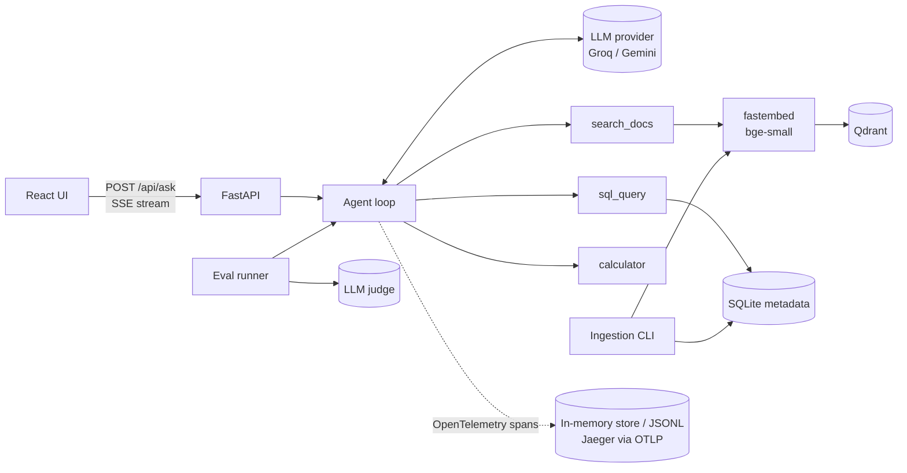

# rag-agent-evals

A document question-answering agent with retrieval-augmented generation, tool use, tracing, and an eval suite that measures it.

Ask a question about a document collection. The agent searches a vector index, queries document metadata with SQL, does arithmetic with a calculator, and streams back an answer that cites the passages it used. Every request is traced (retrieval hits, prompts, tokens, cost, latency). One command runs a golden-set eval and writes a report.

The demo corpus is 25 Python Enhancement Proposals (PEPs), which are public domain. Any folder of PDF, Markdown, reStructuredText or text files works.

<!-- SCREENSHOT -->

## What it does

- **Ingestion**: loads PDF (per page), Markdown, RST and text; splits on headings, then packs paragraphs into ~1,200-character chunks with overlap; prefixes each chunk with its document and section title before embedding; stores per-document metadata (status, type, created date, Python version, word count) in SQLite.
- **Retrieval**: local embeddings with [fastembed](https://github.com/qdrant/fastembed) (`BAAI/bge-small-en-v1.5`, ONNX, no API key) into **Qdrant** (cosine). Qdrant runs as a server under Docker Compose and in embedded mode otherwise, with the same client code.
- **Agent loop**: the model picks tools through native function calling:
  - `search_docs`: semantic search; results are labelled `[S1]`, `[S2]`… so citations resolve back to chunks
  - `sql_query`: read-only SELECT over the metadata table (opened `mode=ro` plus an SQLite authorizer that denies writes)
  - `calculator`: arithmetic through an AST whitelist, no `eval`
- **Streaming API**: FastAPI with Server-Sent Events: tool calls, tool results, answer tokens, then a final event with citations, token usage, estimated cost and latency.
- **Observability**: OpenTelemetry spans per request (`agent.run` → `llm.chat` / `tool.*` → `retrieval.embed_query` / `retrieval.vector_search`) with GenAI semantic-convention attributes: model, input/output tokens, cost, time to first token, prompts and completions, retrieved chunk ids and scores. Spans go to an in-memory store (shown as a waterfall in the UI), a JSONL file, and any OTLP backend (Jaeger in Compose).
- **Swappable LLM provider**: one OpenAI-compatible client covers Groq, Gemini, OpenAI and Ollama; switch with `LLM_PROVIDER` / `LLM_MODEL`.
- **Evals**: 32 hand-written questions with reference answers. Each answer was checked against the PEP text, across five categories: single-document lookup, multi-document, metadata (SQL), calculation, and unanswerable (the agent should decline).
- **UI**: React + TypeScript (Vite): streamed answer with clickable citation chips and source snippets, the agent's tool calls, latency/tokens/cost, and the trace waterfall.

## Architecture



## Eval results

<!-- E2E_RESULTS -->

### Retrieval

Measured on the 23 golden questions that name the documents holding the answer (no API key involved). Generated by `uv run python -m evals.run --retrieval-only` and committed in [`backend/evals/results/latest-retrieval.md`](backend/evals/results/latest-retrieval.md):

| Level | Questions | Hit@1 | Hit@3 | Hit@5 | MRR | Recall@5 |
|---|---|---|---|---|---|---|
| Document | 23 | 96% | 100% | 100% | 0.98 | 98% |
| Answer-bearing chunk | 23 | — | — | 100% | 0.76 | — |

- *Document*: a chunk from a document that holds the answer is in the top 5.
- *Answer-bearing chunk*: a top-5 chunk from that document contains the evidence text recorded for the question. This is stricter; MRR 0.76 means the right passage is usually, but not always, ranked first.
- p50 retrieval latency (query embedding + vector search) was ~180–240 ms on a 2019 Intel MacBook Pro CPU.

**Caveats.** The golden set is small (32 questions) and I wrote it myself after reading the documents, so it is likely easier than real user questions. Each PEP covers one distinct topic, which makes document-level retrieval easy; the answer-bearing-chunk metric is the more informative number. The judge is an LLM, and LLM judges make mistakes; per-question verdicts and reasons are in the report so they can be checked.

## Run it

### Without Docker (verified)

This is the path I ran and verified, on macOS (Intel) with Python 3.12 via [uv](https://docs.astral.sh/uv/) and Node 24.

```bash
cp .env.example .env        # then set GROQ_API_KEY and/or GEMINI_API_KEY
./scripts/dev.sh            # API on :8000, UI on http://localhost:5173
```

The first start indexes the corpus into `data/qdrant` (embedded Qdrant) and `data/metadata.db`. That took about 4–6 minutes on a 2019 Intel MacBook Pro CPU; later starts reuse the index. Without an API key, the API still starts and serves search and health, and the UI shows "LLM not configured".

### With Docker Compose (not verified locally)

```bash
cp .env.example .env
docker compose up --build   # UI http://localhost:3000, API :8000, Jaeger http://localhost:16686
```

Runs Qdrant as a server, the API (embedding model baked into the image), the UI behind nginx (which proxies `/api` with buffering off for SSE), and Jaeger receiving the API's traces over OTLP. **I have not run this locally**: Docker isn't installed on the machine this was built on. CI builds both images on every push.

## Run the evals

```bash
cd backend
uv run python -m evals.run --retrieval-only     # retrieval metrics, no API key
uv run python -m evals.run                      # full suite: agent + LLM judge
uv run python -m evals.run --ids q05,q23        # a subset
```

The full suite runs the agent on each question, then asks a judge model to grade **correctness** against the reference answer and **faithfulness** of the answer to the retrieved context. Alongside these it computes deterministic metrics:

- **citation precision**: cited chunks that come from an expected document
- **tool selection**: the expected tool was called, for SQL and calculator questions
- **latency**: p50/p95
- **tokens and estimated cost** per question

Reports go to `backend/evals/results/` as Markdown and JSON. `--min-hit-rate`, `--min-correctness` and `--min-faithfulness` make the command exit non-zero below a threshold, which is how CI gates on it. Set `JUDGE_PROVIDER` / `JUDGE_MODEL` to grade with a different model from the one answering.

## Tests and CI

```bash
cd backend && uv run pytest     # 48 tests: chunking, PDF loading, tools, agent loop, SSE API, tracing, eval metrics
cd frontend && npm run lint && npm run build
```

Backend tests use a scripted LLM, a hashing embedder and in-memory Qdrant, so they run offline in seconds.

`.github/workflows/ci.yml` runs five jobs:

- **backend**: lint and tests
- **retrieval eval**: gated on Hit@5 ≥ 0.9, no key needed
- **agent eval**: runs only when a `GROQ_API_KEY` or `GEMINI_API_KEY` secret is set
- **frontend**: lint and build
- **docker**: builds the Compose images

## Configuration

All settings are environment variables (or `.env`); see [`backend/app/config.py`](backend/app/config.py) and [`.env.example`](.env.example). The main ones: `LLM_PROVIDER`, `LLM_MODEL`, `GROQ_API_KEY`, `GEMINI_API_KEY`, `JUDGE_PROVIDER`, `JUDGE_MODEL`, `QDRANT_URL`, `CORPUS_DIR`, `TOP_K`, `CHUNK_SIZE`, `OTLP_ENDPOINT`, `TRACE_CAPTURE_CONTENT` (set `false` to keep prompts out of traces).

API keys are read as secrets: they are masked in settings output, and key-like strings are redacted from error messages sent to the client.

To use your own documents, point `CORPUS_DIR` at a folder and run `uv run python -m app.ingest --recreate`. Also update `CORPUS_DESCRIPTION`, which goes into the system prompt.

## Layout

```
backend/app/        config, ingest, retrieval, tools, agent loop, tracing, FastAPI app
backend/evals/      golden.jsonl, eval runner, committed results
backend/tests/      pytest suite
frontend/src/       React UI (SSE client, citations, trace waterfall)
data/corpus/        25 PEPs (public domain / CC0), fetched by scripts/fetch_corpus.py at a pinned commit
```

## Limitations and next steps

- Dense retrieval only; adding BM25 hybrid search and a reranker, then measuring them with the same eval, is the obvious next experiment.
- Cost figures are estimates from a price table in `backend/app/llm.py`; provider prices change.
- The eval set is small and self-written; growing it with real user questions would make the numbers more meaningful.
