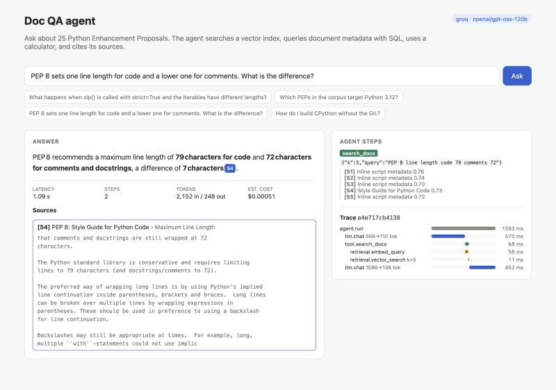
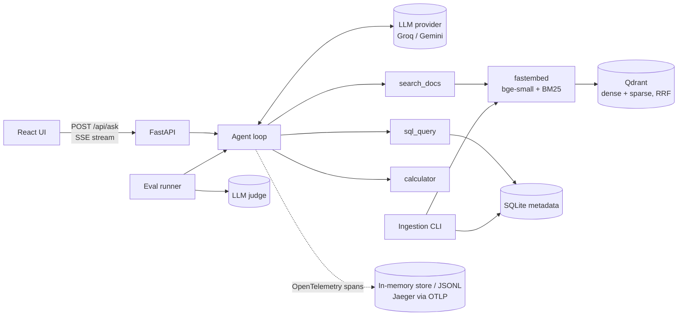

# rag-agent-evals

A document question-answering agent with retrieval-augmented generation, tool use, tracing, and an eval suite that measures it.

Ask a question about a document collection. The agent searches a vector index, queries document metadata with SQL, does arithmetic with a calculator, and streams back an answer that cites the passages it used. Every request is traced (retrieval hits, prompts, tokens, cost, latency). One command runs a golden-set eval and writes a report.

The demo corpus is 25 Python Enhancement Proposals (PEPs), which are public domain. Any folder of PDF, Markdown, reStructuredText or text files works.



*A real answer from `openai/gpt-oss-120b` on Groq: 1.09 s and 2,152 input / 248 output tokens. The trace shows two LLM calls around one search (query embedding 56 ms, vector search 11 ms). This answer also shows a known weakness: the model stated the 79 − 72 difference without calling the calculator.*

## What it does

- **Ingestion**: loads PDF (per page), Markdown, RST and text; splits on headings, then packs paragraphs into ~1,200-character chunks with overlap; prefixes each chunk with its document and section title before embedding; stores per-document metadata (status, type, created date, Python version, word count) in SQLite.
- **Retrieval**: hybrid search in **Qdrant**. Dense vectors from local embeddings with [fastembed](https://github.com/qdrant/fastembed) (`BAAI/bge-small-en-v1.5`, ONNX, no API key) and BM25 sparse vectors are fused with Reciprocal Rank Fusion. Each document also gets a searchable metadata card (authors, status, dates), and a cross-encoder reranker is available as an option. Each choice was measured; see the retrieval table under Eval results. Qdrant runs as a server under Docker Compose and in embedded mode otherwise, with the same client code.
- **Agent loop**: the model picks tools through native function calling:
  - `search_docs`: semantic search; results are labelled `[S1]`, `[S2]`… so citations resolve back to chunks
  - `sql_query`: read-only SELECT over the metadata table (opened `mode=ro` plus an SQLite authorizer that denies writes)
  - `calculator`: arithmetic through an AST whitelist, no `eval`
- **Streaming API**: FastAPI with Server-Sent Events: tool calls, tool results, answer tokens, then a final event with citations, token usage, estimated cost and latency.
- **Observability**: OpenTelemetry spans per request (`agent.run` → `llm.chat` / `tool.*` → `retrieval.embed_query` / `retrieval.vector_search`) with GenAI semantic-convention attributes: model, input/output tokens, cost, time to first token, prompts and completions, retrieved chunk ids and scores. Spans go to an in-memory store (shown as a waterfall in the UI), a JSONL file, and any OTLP backend (Jaeger in Compose).
- **Swappable LLM provider**: one OpenAI-compatible client covers Groq, Gemini, OpenAI and Ollama; switch with `LLM_PROVIDER` / `LLM_MODEL`.
- **Evals**: 65 hand-written questions with reference answers, each checked against the PEP text. They cover five categories: single-document lookup, multi-document, metadata (SQL), calculation, and unanswerable (the agent should decline). They come in two sets:
  - a *core* set of 32 questions
  - a *hard* set of 33: paraphrased questions that avoid the documents' wording, facts that appear only in document headers, and false-premise questions
- **UI**: React + TypeScript (Vite): streamed answer with clickable citation chips and source snippets, the agent's tool calls, latency/tokens/cost, and the trace waterfall.

## Architecture



## Eval results

### End-to-end agent

<!-- E2E_RESULTS:START -->
Measured 2026-10-27 15:25 UTC on the 32 core golden questions. Answer model `groq/openai/gpt-oss-120b`, judge `groq/qwen/qwen3.8-27b`, retrieval `hybrid+cards`. Full per-question report: [`backend/evals/results/20261027-154535-core-openai_gpt-oss-120b.md`](backend/evals/results/20261027-154535-core-openai_gpt-oss-120b.md).

Run on Groq's free tier. During the whole run, the provider returned 106 rate-limit (HTTP 429) responses, which the client retried after waiting. Those waits are included in the latency figures.

**Hard set (33 questions): pending a complete run.** In the same run, Groq's free-tier daily cap of 200,000 tokens ran out after 4 hard questions. Those 4 were answered correctly; the other 29 failed on the quota and are not scored here. The raw record is [`20261027-154535-openai_gpt-oss-120b.md`](backend/evals/results/20261027-154535-openai_gpt-oss-120b.md). To finish it after the quota resets: `./scripts/run-evals.sh --difficulty hard`. The eval stops cleanly when a daily quota runs out, and it does not write partial results into this README.

| Correctness | Faithfulness | Citation precision | Tool selection | p50 / p95 latency | Avg tokens (in / out) | Avg cost / question | Errors |
|---|---|---|---|---|---|---|---|
| 100% | 100% | 98% | 86% | 9693 / 22967 ms | 2772 / 265 | $0.00061 | 0 |

#### By category

| Category | Questions | Correctness | Faithfulness | Citation precision | Tool selection |
|---|---|---|---|---|---|
| calculation | 3 | 100% | 100% | 100% | 67% |
| lookup | 20 | 100% | 100% | 98% | — |
| metadata_sql | 4 | 100% | 100% | — | 100% |
| multi_doc | 2 | 100% | 100% | 100% | — |
| unanswerable | 3 | 100% | 100% | — | — |
<!-- E2E_RESULTS:END -->

### Retrieval: what each change bought

Every pipeline below runs on the same index and the same 65 questions; no API key involved. Generated by `uv run python -m evals.compare_retrieval` and committed in [`backend/evals/results/retrieval-comparison.md`](backend/evals/results/retrieval-comparison.md).

| Pipeline | Doc Hit@1 | Answer chunk Hit@5 | Answer chunk MRR | MRR, core set | MRR, hard set | p50 latency |
|---|---|---|---|---|---|---|
| `dense` (first version) | 96% | 76% | 0.55 | 0.76 | 0.32 | 141 ms |
| `dense` + metadata cards | 96% | 87% | 0.62 | 0.76 | 0.48 | 124 ms |
| **`hybrid` (dense + BM25, RRF) + cards** (default) | 96% | **89%** | **0.72** | **0.88** | 0.56 | 177 ms |
| `dense` + cards + reranker | 94% | 84% | 0.74 | 0.85 | 0.63 | 3,325 ms |
| `hybrid` + cards + reranker | 94% | 84% | 0.75 | 0.84 | 0.66 | 4,494 ms |

- *Doc Hit@1*: the top chunk comes from a document that holds the answer.
- *Answer chunk*: a top-5 chunk from that document contains the evidence text recorded for the question in the golden set. This is the stricter and more informative measure: each PEP covers one topic, so finding the right document is easy, but finding the right passage is not.
- **Metadata cards**: in the first version, a PEP's header (authors, sponsor, PEP-Delegate, status, dates) was parsed into SQLite but never indexed. A question like "who wrote the data classes PEP?" therefore had no passage to retrieve. Adding one card per document fixed those questions.
- **Hybrid search**: BM25 sparse vectors alongside the dense ones, with candidates fused by Reciprocal Rank Fusion inside Qdrant. It helps literal queries such as option names, environment variables and code.
- **Reranker** (`ms-marco-MiniLM-L-6-v2` cross-encoder over 20 candidates): it ranks the hard questions better (MRR 0.56 → 0.66). It also pushes some answer-bearing chunks out of the top 5 and costs about 25× the latency on this CPU, so it is off by default (`RERANK=true` turns it on).
- Latency is measured on a 2019 Intel MacBook Pro CPU, query embedding included.

**Reading the end-to-end numbers.**

- I read the core-set answers and agree with the judge's verdicts.
- The one tool-selection miss: on q27 the model stated a 79 − 72 = 7 difference without calling the calculator, despite the prompt asking it to. It did this in both runs.
- The one citation outside the expected document: on q03, besides PEP 257, the model also cited PEP 8, which does discuss docstrings.
- An earlier run on the same 32 questions with plain dense retrieval also scored 100% correct ([report](backend/evals/results/20261027-145651-openai_gpt-oss-120b.md)). The core set is too easy to separate the pipelines end to end. That is why the hard set exists, and why the retrieval comparison above is the more informative measurement.

**Caveats.** The golden set is small (65 questions) and I wrote it myself after reading the documents, so it is likely easier than real user questions. Each PEP covers one distinct topic, which makes document-level retrieval easy; the answer-bearing-chunk metric is the more informative number. The judge is an LLM, and LLM judges make mistakes; per-question verdicts and reasons are in the report so they can be checked.

## Run it

### Without Docker (verified)

This is the path I ran and verified, on macOS (Intel) with Python 3.12 via [uv](https://docs.astral.sh/uv/) and Node 24.

```bash
cp .env.example .env        # then set GROQ_API_KEY and/or GEMINI_API_KEY
./scripts/dev.sh            # API on :8000, UI on http://localhost:5173
```

If those ports are taken, set `API_PORT` / `WEB_PORT`, e.g. `API_PORT=8011 WEB_PORT=5181 ./scripts/dev.sh`.

The first start indexes the corpus into `data/qdrant` (embedded Qdrant) and `data/metadata.db`. That took about 4–6 minutes on a 2019 Intel MacBook Pro CPU; later starts reuse the index. Without an API key, the API still starts and serves search and health, and the UI shows "LLM not configured".

### With Docker Compose (not verified locally)

```bash
cp .env.example .env
docker compose up --build   # UI http://localhost:3000, API :8000, Jaeger http://localhost:16686
```

Runs Qdrant as a server, the API (embedding model baked into the image), the UI behind nginx (which proxies `/api` with buffering off for SSE), and Jaeger receiving the API's traces over OTLP. **I have not run this locally**: Docker isn't installed on the machine this was built on. CI builds both images on every push.

## Run the evals

One command produces the real end-to-end numbers and writes them into this README:

```bash
./scripts/run-evals.sh
```

It reads `GROQ_API_KEY` / `GEMINI_API_KEY` from `.env` and answers with `LLM_PROVIDER`: by default Groq, model `openai/gpt-oss-120b`. A model never grades its own answers. When both keys are set, the other provider judges; with only a Groq key, `qwen/qwen3.8-27b` judges. Stop `scripts/dev.sh` first: the embedded index allows one process at a time. Free-tier rate limits can slow the run. The client retries on HTTP 429, and anything that still fails is listed as an error in the report.

Lower-level commands:

```bash
cd backend
uv run python -m evals.run --retrieval-only     # retrieval metrics, no API key
uv run python -m evals.run                      # full suite: agent + LLM judge (needs a key)
uv run python -m evals.run --ids q05,q23        # a subset
uv run python -m evals.compare_retrieval        # compare retrieval pipelines, no API key
```

The full suite runs the agent on each question, then asks a judge model to grade **correctness** against the reference answer and **faithfulness** of the answer to the retrieved context. Alongside these it computes deterministic metrics:

- **citation precision**: cited chunks that come from an expected document
- **tool selection**: the expected tool was called, for SQL and calculator questions
- **latency**: p50/p95
- **tokens and estimated cost** per question

Reports go to `backend/evals/results/` as Markdown and JSON. `--min-hit-rate`, `--min-correctness` and `--min-faithfulness` make the command exit non-zero below a threshold, which is how CI gates on it. Set `JUDGE_PROVIDER` / `JUDGE_MODEL` to grade with a different model from the one answering.

## Tests and CI

```bash
cd backend && uv run pytest     # 57 tests: chunking, PDF loading, retrieval pipelines, tools, agent loop, SSE API, tracing, eval runner
cd frontend && npm run lint && npm run build
```

Backend tests mock every LLM call with a scripted model, and use a hashing embedder and in-memory Qdrant, so they need no API key and run offline in seconds. This covers the agent loop, the SSE endpoint, tracing, and the eval runner including the judge.

`.github/workflows/ci.yml` runs five jobs:

- **backend**: lint and tests
- **retrieval eval**: gated on Hit@5 ≥ 0.9, no key needed
- **agent eval**: makes real LLM calls, so it runs only when a `GROQ_API_KEY` or `GEMINI_API_KEY` repository secret is set; without one it skips
- **frontend**: lint and build
- **docker**: builds the Compose images

## Configuration

All settings are environment variables (or `.env`); see [`backend/app/config.py`](backend/app/config.py) and [`.env.example`](.env.example). The main ones: `LLM_PROVIDER`, `LLM_MODEL`, `GROQ_API_KEY`, `GEMINI_API_KEY`, `JUDGE_PROVIDER`, `JUDGE_MODEL`, `QDRANT_URL`, `CORPUS_DIR`, `TOP_K`, `RETRIEVAL_MODE` (`hybrid` or `dense`), `RETRIEVAL_CARDS`, `RERANK`, `CHUNK_SIZE`, `OTLP_ENDPOINT`, `TRACE_CAPTURE_CONTENT` (set `false` to keep prompts out of traces).

API keys are read as secrets: they are masked in settings output, and key-like strings are redacted from error messages sent to the client.

To use your own documents, point `CORPUS_DIR` at a folder and run `uv run python -m app.ingest --recreate`. Also update `CORPUS_DESCRIPTION`, which goes into the system prompt.

## Layout

```
backend/app/        config, ingest, retrieval, tools, agent loop, tracing, FastAPI app
backend/evals/      golden.jsonl, eval runner, committed results
backend/tests/      pytest suite
frontend/src/       React UI (SSE client, citations, trace waterfall)
data/corpus/        25 PEPs (public domain / CC0), fetched by scripts/fetch_corpus.py at a pinned commit
```

## Limitations and next steps

- The reranker was measured but left off: on CPU it costs seconds per query. A smaller reranker, or reranking fewer candidates, is worth measuring next.
- Cost figures are estimates from the price table in `backend/app/llm.py` ($0.15 input / $0.75 output per million tokens for `openai/gpt-oss-120b`). I could not confirm Groq's current price list, so check it before relying on the cost numbers. Judge calls are not included in cost per question.
- The eval set is small and self-written; growing it with real user questions would make the numbers more meaningful.
